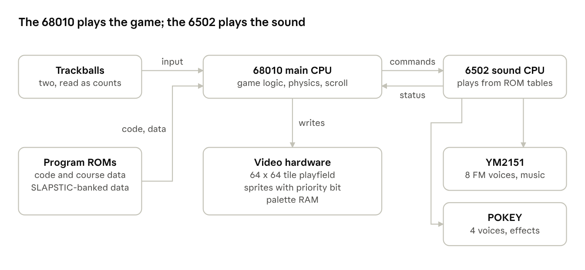
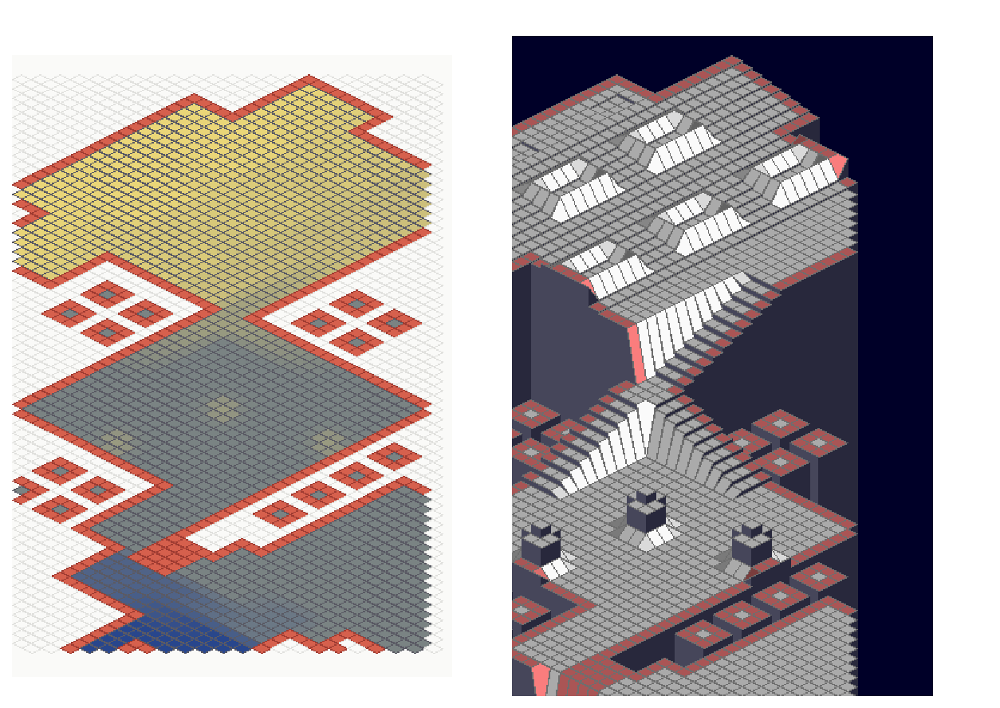
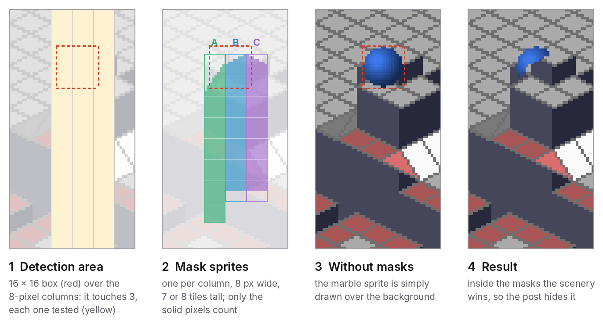
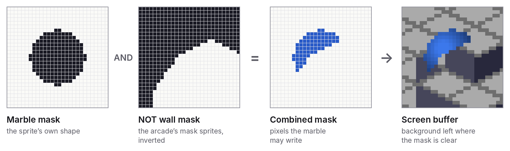

# Inside Marble Madness: How the 1984 Arcade Game Works

*By Michael · November 2026*

Marble Madness (Atari Games, 1984) fits a 3D-looking world, rolling physics, two-player racing and a full musical score into a 68010, a 6502 and about half a megabyte of ROM. This paper explains how, from the program itself.

The findings come from rebuilding the arcade game in Python, routine by routine, from the original ROM set. Every part described here was checked against the arcade running in the MAME emulator: recorded games were replayed through the rebuilt engine and compared with MAME's memory frame by frame, until the marble's position, the scroll, the enemies and the score matched exactly.

The interesting parts are the ones a player never sees: how six large courses are squeezed into a few ROM chips, how a flat sprite is hidden behind isometric walls, how one routine drives every moving object, and how a sound chip plays music that waits for the player. Addresses in the text (such as `0x1A668`) are locations in the 68010 program or, where marked, the 6502 sound program, so each claim can be found and checked.

## The hardware

Marble Madness was the first game on Atari System 1, a board with two processors that share the work cleanly: a Motorola 68010 runs the game, and a MOS 6502 runs the sound. They never share memory; the only link is a one-byte command latch and a status bit.

*Atari System 1 as Marble Madness uses it*

The 68010 reads the trackballs, runs the physics and objects, and writes the screen. The screen is built from two layers: a 64 × 64 tilemap for the scenery, and hardware sprites (motion objects) for the marbles and enemies, each with a priority bit that the wall-masking trick depends on. All colours come from palette RAM, which is what makes the colour-script animations so cheap.

The main program is written mostly in C, compiled to 68010 code with the usual stack frames, with hand-written assembly for the hot paths such as the row decompressor. Part of the course data sits behind Atari's SLAPSTIC protection chip, described in the next section.

## Storing the courses

Each course is kept as two separate things: a compressed picture of the scenery, and a short list of building blocks from which the floor's shape is rebuilt at the start of every race. Neither is stored as a plain map.

### The scenery: a column of compressed rows

A course is a tall strip 36 tiles (288 pixels) wide. Each row of tiles is compressed on its own, so the game can decode just the row that is about to scroll into view. The 64 × 64 tile playfield is used as a circular buffer: decoded rows are written into columns 3 to 38 as the screen moves, and the rest of the tilemap is never touched by the level code.

The row decoder at `0x1A668` is hand-written assembly in an otherwise mostly C program. It reads a bitstream most-significant bit first, with a 14-bit look-ahead window, and recognises five kinds of code:

| Code (bits)                   | Length  | Produces                                                       |
|-------------------------------|---------|----------------------------------------------------------------|
| 1 + 12-bit tile + flag        | 14 bits | One literal tile; if the flag is set, it is remembered as LAST |
| 0 000 + 3-bit count           | 7 bits  | 1-8 tiles counting up from LAST: LAST+1, LAST+2, …             |
| 0 kkk + 3-bit count (k = 1-4) | 7 bits  | 1-8 copies of one of four fixed tiles (blanks and plain floor) |
| 0 101 or 0 110 + 3-bit count  | 7 bits  | 1-8 tiles alternating between two fixed tiles                  |
| 0 111 + 5-bit index           | 9 bits  | One tile from a 32-entry dictionary at `0x2499A`                 |

The counting-up code is the clever one. The art was drawn as large pictures and then cut into 8 × 8 tiles in order, so neighbouring tiles usually have consecutive numbers, and a whole run costs 7 bits. A second, separate stream of (count, value) byte pairs adds the palette bits to each tile, so colour runs and shape runs are compressed independently.

### Behind the protection chip

The row tables and bitstreams sit in a 32 KB ROM behind Atari's SLAPSTIC protection chip. Only one of its four 8 KB banks is visible at a time, and a bank is chosen by reading particular addresses in a particular order (routine `0x2FFB8`). That is why every bitstream starts at `0x800E4`: the first bytes of each bank are the chip's own trigger addresses. Practice uses bank 1, Beginner and Intermediate bank 2, Aerial and Silly bank 3, and Ultimate bank 0.

The floor-shape data is protected even more tightly. While the floor is being built, the visible bank can change after every building block, including once from a read the 68010 makes only because it fetches instructions ahead of executing them (at `0x2FF5A`). Reading this data correctly means simulating the chip's state machine; the remake uses the SLAPSTIC 137412-103 model from the open-source [marble-love](https://github.com/magno73/marble-love) project.

### The floor: built at the start of each race

The heights the marble rolls on are not stored as a grid. At race start, routine `0x1A444` and the rasteriser at `0x1AD54` build them from a list of 8-byte primitives:

| Bytes | Meaning                                                  |
|-------|----------------------------------------------------------|
| 0-3   | Start and length along the two lattice axes              |
| 4-5   | Base height (`0x4000` = reference level, 1 unit = 1 pixel) |
| 6     | Flags, and which height profile to use                   |
| 7     | Direction (one of 8) and an "invert" flag                |

A profile is a short list of signed height steps that repeats, so one primitive can lay a ramp, a hill or a curved bank. A separate stream lists, for each 24-row chunk, which primitives touch it, plus patches for special cells such as moving floors. The result is a grid of cells on a staggered isometric lattice, 22 cells per row, each with four corner heights.

The game then packs a 10-bit index for each cell and stores the whole grid in the playfield columns that are never displayed (39-63). Anyone who has looked at Marble Madness in MAME's tilemap viewer has seen this as a strange pattern beside the course: it is the collision map, hidden in video memory.

The picture below shows the top of the Beginner Race as the game rebuilds it, drawn purely from the height data with none of the course art. On the left is the map as stored: one diamond per cell, coloured from low (blue) to high (yellow), with special-code cells, such as edges and moving parts, in red. On the right the same numbers are drawn as solid blocks, and the course's shapes appear: the raised steps, the ramp down to the lower level and the four little posts.

### Colours

Each race has its own set of 195 colour words, copied by routine `0x26B2A` to scattered places in palette RAM. A colour is 16 bits: 4 bits of intensity, then 4 each of red, green and blue.

## The isometric world

The game works in true 3D coordinates and only turns them into screen positions at the last moment, with one cheap formula. Every moving thing has an X, a Y and a Z (height), each a 32-bit fixed-point number: the top 16 bits are whole pixels and the bottom 16 bits the fraction. Velocities use the same format, so a marble can creep at 1/65536 of a pixel per update.

X and Y run along the two diagonal edges of the floor tiles, and one floor cell is 8 units along each. Shifting a position right by 19 bits (16 for the fraction, 3 for the cell size) gives the cell it is in, with no multiply or divide. Heights use `0x4000` as the reference floor level, and one height unit is one screen pixel.

Routine `0x1B9CC` projects a position onto the screen:

$$
\text{screen}_x = y - x + 136
$$

$$
\text{screen}_y = \text{scroll} + z + 84 - \frac{x + y}{2}
$$

This is a 2:1 isometric projection: a step along either axis moves one pixel sideways and half a pixel vertically, and height adds straight to the screen Y. It needs only additions, a subtraction and one shift, which matters on a CPU where a multiply costs tens of cycles and the projection runs for every moving object.

The same routine has a small trick to stop sprites shimmering. It keeps the last three screen positions, and a new position equal to either of the two before it is ignored. A marble rocking between two pixels therefore stays still on screen.

To find the floor under a marble, the game takes the four corner heights of its cell from the collision map hidden in video memory, and interpolates between them by the marble's position inside the cell. The same corner heights, compared with the neighbouring cells, tell the physics where the floor drops away or a wall rises.

## Hiding the marble behind walls

The hardware has no depth buffer: sprites are always drawn over the scenery. Marble Madness still makes the marble disappear behind walls and under bridges, by placing invisible "mask" sprites in front of it that let the scenery show through.

### The priority trick

On Atari System 1, each sprite has a priority bit. Where a sprite with that bit set has solid pixels, the playfield is shown on top of any ordinary sprite underneath. A mask sprite is never seen itself: it is a stencil, shaped like the edge of a wall, that punches the scenery back over the marble.

The mask shapes are ordinary sprite tiles drawn to match the outlines of wall edges, slopes and corners. A mask entry is one 16-bit code: bits 0-10 the first tile, bits 11-13 the height in tiles minus one (so one entry covers a column up to 8 tiles tall), and bit 15 a mirror flag, which gives each wall shape both of its isometric orientations for free.

The four panels show one real moment: the marble parked just behind one of the posts on the Beginner Race. Its 16 × 16 box rarely lines up with the 8-pixel screen columns, so it usually touches three of them, and routine `0x264AA` tests each one. Here all three find the post rising in front of the marble, so each gets a mask sprite (A, B, C): 8 pixels wide and 7 or 8 tiles tall, its top edge cut to the post's outline. The faint frames show each sprite's full size; only its solid pixels hand the screen back to the scenery. The scenery is drawn from the course's height data and the marble is a plain disc, but the mask shapes and their positions are the game's own.

### The same idea on a home computer

The arcade hides the marble with a hardware priority bit, but the mask itself is just a 1-bit shape, and that makes it easy to carry over to the home computers of the day. Those machines usually drew moving objects in software or with a blitter, straight into the screen's bitmap, because their hardware sprites could not be placed behind an arbitrary shape in the scenery.

A software sprite already needs a mask of its own, the "cookie cutter" that stops a rectangle of background being wiped around it. Every pixel, or every word of pixels at once, is drawn as:

$$
\text{screen} = (\text{screen} \land \lnot\,\text{mask}) \lor (\text{sprite} \land \text{mask})
$$

The arcade's wall masks fit straight into this. Before drawing, the marble's own mask is ANDed with the inverse of the wall mask:

$$
\text{mask}' = \text{marble mask} \land \lnot\,\text{wall mask}
$$

The marble is then drawn with that combined mask. Where the wall should be in front, the marble's pixels are never written, so the background already in the buffer stays, which looks the same as the arcade's priority bit. The cost is one extra AND per word, and the same detection routine still decides which columns need a mask. A blitter with several sources can do the combining as a separate pass before the usual cookie-cut draw.

### Deciding where the masks go

Routine `0x264AA` runs for every visible marble on every update. It works in vertical strips:

1.  Split the marble's 16-pixel box into the 8-pixel screen columns it overlaps.

2.  For each column, look up the terrain in front of the marble in the collision map, using routine `0x177F8` to get the height of each cell's top edge.

3.  If that terrain rises above the marble's height, add a mask sprite for that column, at the wall's position.

4.  Keep at most 5 masks per marble.

Where the automatic test gets a spot wrong, for instance a pipe mouth or a thin overhang, a hand-made table at `0x1EA2A` lists special cases per screen column. Rebuilding the game showed both sources were needed: the heights account for most masks, and the table fixes the rest.

One more saving: when every column of the marble is covered, the routine clears the marble's "visible" flag, and the marble is not drawn at all. That frees sprite slots on a machine that can only show so many per line.

The same routine, with a different mode argument, hides the Beginner Race's hopping acid hazards and the Silly Race's dropped creatures, so every object that can go behind scenery uses the same method.

## Rolling physics

The marble's movement is a short chain of integer routines, run once per update, with no floating point and almost no division. Each step changes the velocity a little, and the position is then moved by the velocity.

| Step            | Routine          | What it does                                                                                                              |
|-----------------|------------------|---------------------------------------------------------------------------------------------------------------------------|
| Trackball       | `0x17F66`          | Each trackball count adds `0x160` to the velocity (about 1/186 pixel per update)                                            |
| Gravity         | `0x17F66`          | While airborne, `0x6000` (0.375 pixel) is taken from the vertical speed each update, down to a limit of 5 pixels per update |
| Slope           | `0x25DF6`          | The floor's slope times 2048 is taken from the velocity; slopes steeper than 12 pull four times as hard                   |
| Drag            | `0x25E7C`          | The velocity is scaled down by a factor that depends on speed and surface                                                 |
| Edges and walls | `0x1706C`, `0x1B5C2` | Velocity is nudged along ledges; at a wall it is flipped and the position restored                                        |
| Landing         | `0x25C74`          | The size of the drop decides between a bounce, a daze, or breaking                                                        |

### Speed without a square root

Drag depends on the marble's speed, which strictly needs a square root. Routine `0x25E7C` instead uses a standard approximation: the larger of the two velocity parts plus 3/8 of the smaller. It is never more than about 7% off, and costs one shift, one multiply by 3 and an add.

The speed then indexes a 16-entry table at `0x1EEF8`, and the next 3 bits interpolate between neighbouring entries. Different surfaces change the result: normal floor, ice-like surfaces with almost no drag, and the grates, which drag five times harder across them than along them, so a marble tends to follow their direction.

### Landing and breaking

Each marble has an impact meter. A landing adds the height of the drop to it; if the average of the meter and the drop goes over 31, the landing is a hard one. After a hard landing on screen, the marble plays its break-up animation: it shatters, a broom sweeps up the pieces, and it reappears. If the marble is partly off screen, the animation is skipped and it goes straight back to the last restart point.

### Small touches

- In a one-player game both trackballs steer the marble. Routine `0x180BE` takes the input from whichever moved more that frame, so a player can use either.

- When two marbles, or a marble and an enemy, touch, routine `0x1BC88` swaps their velocities and pushes them apart.

- The Silly Race reverses the slope pull with a single test on the race number, so the marble rolls uphill.

## Scripted objects, enemies and chance

Most of the moving scenery is not written as code at all. Each course carries small programs in a compact bytecode, and one interpreter at `0x12896` runs them for every object. A designer could add a moving platform or a timed gate by writing a few words of data instead of a new routine.

### The bytecode

Each object has its own program counter. Every update, the interpreter runs that object's instructions until it reaches one that waits, then moves on to the next object. Instructions are 16-bit words followed by their arguments:

| Opcode  | Meaning                                                            |
|---------|--------------------------------------------------------------------|
| 0       | Create: set position, type and first animation                     |
| 1       | Move every n frames, then wait                                     |
| 2       | Animate every n frames, then wait                                  |
| 3       | Wait n updates                                                     |
| 4 / 5   | Start a loop of n turns / loop back                                |
| 6 / 7   | A second, nested loop                                              |
| 8       | Branch if a marble is within 3 cells                               |
| 9       | Jump                                                               |
| 10 / 11 | Call a sub-script / return                                         |
| 12 / 13 | Choose the animation or movement sequence                          |
| 14      | Set velocity                                                       |
| 16      | Add velocity to position                                           |
| 17 / 18 | Wait for a marble in a zone / branch when every marble has left it |

Two loop counters, one return address and a "marble nearby" test turn out to be enough for every moving part in the six courses. The interpreter is effectively a tiny cooperative multitasking system: each object yields at its wait instruction, so dozens of them share the CPU without any scheduler.

### Hand-written enemies

Characters that chase or react to the marble get their own routines, but they reuse the same building blocks:

- **Slinkies** (Intermediate and Ultimate) walk cell by cell along a looping path of nodes, and speed up while a marble is in their zone. A marble that touches one is caught, pulled one pixel per update towards the slinky's middle, and lost when the hold animation ends.

- **Pop-up blocks** (Aerial): 36 blocks start when a marble enters zone 4 or 5. Each counts down, rises and falls, and waits again. A block that is up acts as a wall; one that rises under the marble throws it into the air.

- **Hopping hazards** use the same wall-masking routine as the marble, so they too can go behind scenery.

### Random numbers

The game's randomness comes from one 16-bit shift register at `0x4003A6`, routine `0x13A98`. Each new bit is taken from bits of the register's two bytes XORed together. The routine is clocked once for each bit of the range asked for, then the result is masked and reduced until it falls below that range.

Because the register only moves when something asks for a number, the sequence depends on exactly what has happened in the game so far. That is why an emulator recording replays identically, and why the rebuilt game had to call the generator at exactly the same moments as the original before the pop-up timings (one of four timing sets for the last 12 blocks, picked at random) and the hammers' patterns would match.

## Scrolling and two players on one screen

Two marbles share one screen that only scrolls up and down. The game solves this with a lazy scroll that follows whichever marble leads, and a rule that brings a marble left behind back into view, at a price.

### The scroll

The game logic runs at 30 updates per second, and the scroll (routine `0x13EE6`) is the first thing in each update. To save time it only checks the marbles once every 8 updates, unless a scroll is already moving:

1.  A marble below screen line 72 starts the screen scrolling down the course; one above line 168 scrolls it back. On the Silly Race, which runs the other way, the two lines swap roles.

2.  The speed is 1, 2 or 4 lines per update, depending on how far past the line the marble is.

3.  Once started, the scroll keeps going until the marble is 16 lines back inside the window, and stops at either end of the course.

4.  When no marble needs it any more, it eases on for a few more lines instead of stopping dead.

The gap between the two lines is a "dead zone" of 96 lines in which the marble moves freely and the screen stays still. Checking only every 8 updates both saves time and stops the view jittering as the marble rocks back and forth.

As the view moves, only the new row of tiles is decoded into the circular playfield buffer, so a scroll costs one row of decompression rather than a full redraw.

### Falling behind

In a two-player race the screen follows the leader, so the other marble can drop off the edge. Routine `0x251DE` checks for a marble that has left the screen while on the ground and puts it back near the other one, at a cost of 5 seconds off its clock and counted as a death.

Where it reappears is chosen by routine `0x17934`: the restart point of the leader's zone (or a zone allowed with it) that is free, and nearest the top of the window around the leading marble. The catch-up reuses the course's own restart points, so a returning marble always lands somewhere the designers chose as safe to start from.

## Animation by colour alone

Some of the most eye-catching effects in Marble Madness move no pixels at all: they change a few colour registers and let the hardware recolour the whole screen at once. The goal line lighting up, the wave machine on Intermediate and the shimmering Ultimate Race floor all work this way.

### Palette scripts

A palette change is a small record in ROM, listed in a table at `0x20AE4`. Each record holds a count, an index into a list of palette addresses at `0x20840`, and then the new colour words. Game code asks for a change by number (routine `0x26B66` queues it) and routine `0x26B88` writes it during the next update. The records in use include:

| Change | Used for                                                                      |
|--------|-------------------------------------------------------------------------------|
| 0-3    | The wave machine on Intermediate, picked by the wave's current position       |
| 4-7    | The goal outline, one colour per player and race type, when a marble finishes |
| 8-9    | Aerial Race scenery                                                           |
| 12-17  | The Ultimate Race floor, cycled every 7 frames                                |
| `0x13`   | The title logo colours                                                        |

Because the scenery tiles store palette numbers, not colours, the art for a glowing goal line or a rolling wave is drawn once. The animation is just a handful of word writes per frame, far cheaper than redrawing tiles.

### Colours you were never meant to see

In the stored palettes, the entries that these scripts animate hold the dummy value `0xABCD`. A still picture made from the ROM data alone shows them as flat grey patches. In the running game the scripts fill them in, so a player never sees the grey.

### The colour format

Each colour is one 16-bit word: 4 bits each of red, green and blue, plus 4 bits of intensity that scale all three together. The intensity steps are not even: level 0 is black, and levels 1 to 15 run from 3 to 17 on a common scale. One field can therefore dim or brighten a colour without changing its hue.

## The sound system

Sound runs on a separate 6502 processor with its own ROMs, and the main program talks to it only by writing one-byte command numbers. Everything else is decided by tables in the sound ROMs: what a command does, which voice it uses, how important it is, and what happens when it ends. The game code just says "marble landed" or "race over".

### Talking to the sound CPU

The 68010 writes a command to a latch at `0xFE0000`. Before writing it checks a status bit (bit 7 of `0xF60001`) to see that the 6502 has collected the previous command; writing blind would lose sounds when two events happen in the same frame. Two kinds of traffic run all the time alongside the game's commands:

- A status command (`0x03`) every frame.

- A "ping" (`0x07`) every 8 frames. If the 6502 fails to answer 9 times in a row, the main program assumes it has crashed and resets it. A watchdog for the sound CPU is unusual, and it made the first recordings for this project cut off after about a second, until the replay tools were taught to answer it.

### What a command means

On the 6502 side, each command number indexes a set of parallel tables. The first says what kind of command it is:

| Type | Effect                                                  |
|------|---------------------------------------------------------|
| 6    | Start a sound or tune                                   |
| 4    | Stop one                                                |
| 8    | Fade one out                                            |
| 2    | Stop everything (or set the cabinet lamps)              |
| 0    | Set the volume threshold (lower volume in attract mode) |
| 1    | Set or clear a "group flag" that running music can test |

Other tables give each sound its first track, which voice it plays on (four POKEY channels for effects, eight YM2151 FM channels for music), its priority and the track that follows it.

### Priority instead of mixing

There is no software mixer. A new sound takes its voice only if its priority is at least that of the sound already playing there; one of equal priority replaces it. Important sounds such as a marble breaking therefore always cut through rolling noises, and a busy moment never needs more voices than the hardware has.

It also means the game has to switch sounds off deliberately. The rolling sound plays until code says otherwise, and the rebuilt game initially left it running in five places where the original quietly stops it, such as when a wobble ends, a hard landing begins or a break-up finishes.

### Music that waits for the player

The Aerial Race shows the cleverest trick. Its tune loops until the marble reaches a certain point in the course, then moves on to a new section of music, without the main CPU sequencing a single note. When the marble crosses that point the game sends command `0x12`, which sets group flag 1. Inside the music data, an instruction at 6502 address `0x92D5` tests that flag every time the loop comes round, every 97 frames (about 1.6 seconds), and jumps ahead to the next part when it is set.

The music therefore changes on its own next beat rather than mid-phrase: the game only raises a flag, and the composer's data decides when to act on it. This branch was the last missing piece of the score in the rebuilt game, and was found with MAME's debugger by stopping the 6502 at the moment the new tune started.

## Quirks the remake had to copy

A faithful rebuild has to reproduce what the code does, not what its authors meant, because the recorded games depend on every detail. These were the oddities that mattered most.

- **A protection chip moved by a read nobody wrote.** While the floor is built, one SLAPSTIC bank switch is triggered by an instruction fetch the 68010 makes ahead of time at `0x2FF5A`, not by any deliberate read. A copy of the game that does not model the CPU's prefetch reads the wrong height profiles and builds the wrong floor.

- **Only the low byte reaches the sound CPU.** Sound numbers are stored in tables of 32-bit entries, but the routine that sends them passes on only the lowest byte. Where the game indexes such a table out of its range, it reads part of a neighbouring value, and whatever low byte that holds becomes the command. The remake reads the same bytes and masks them the same way.

- **The random numbers never restart.** The shift register is not reset between races or games, so the same course plays differently depending on everything that happened before it. The remake carries the register over from race to race in the same way.

- **Bugs in the copy, not the original.** Several problems found along the way turned out to be mistakes in the rebuild: the rolling sound not being stopped in five places, and a choice between ledge candidates at table `0x2398C`, where the ROM keeps the smallest and an earlier open-source port kept the largest. Each was settled by comparing against MAME, not by deciding which behaviour seemed more sensible.

## How this was worked out

Every finding in this paper was checked against the arcade itself, running in MAME, rather than taken from memory or documentation. The work followed one loop: port a routine, run it beside the original, and compare until they agree.

1.  **Read the program.** The 68010 code was disassembled and decompiled, and each routine was ported to Python under its ROM address (for example cover_264aa for the routine at `0x264AA`), so any line of the remake can be traced back to the original.

2.  **Decode the data.** Course graphics, height maps and palettes were decoded straight from the ROM chips. The collision map was checked by packing it into the game's own 10-bit format and comparing it with MAME's video memory: Practice matched exactly and Beginner to 99.8%, the difference being cells animated at run time.

3.  **Replay real games.** Games were recorded in MAME as input files, then replayed through the remake with the same trackball inputs on the same frames. The marble's position, the scroll, the enemies and the score were compared with MAME's memory frame by frame.

4.  **Listen.** For sound, each of the 71 commands was played on the real 6502 code in MAME and recorded, and the timing of loops, fades and the music branches was matched against video recordings of real play.

5.  **Ask the debugger when stuck.** Where the behaviour could not be explained from the code alone, MAME's debugger was stopped at the moment it happened, such as the Aerial Race's second tune, found by breaking on the 6502 instruction that makes the jump.

The open-source [marble-love](https://github.com/magno73/marble-love) project by Marco Magnocavallo provided the SLAPSTIC model and the floor rasteriser that the collision map is built with.

## Sources

- The Marble Madness arcade ROM set (MAME set marble), from which every address in this paper is taken.

- [MAME](https://www.mamedev.org/), used to run, record and debug the original.

- [marble-love](https://github.com/magno73/marble-love), MIT License.
